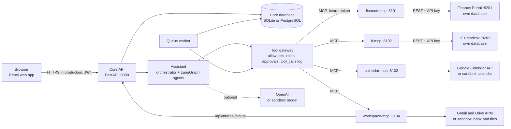
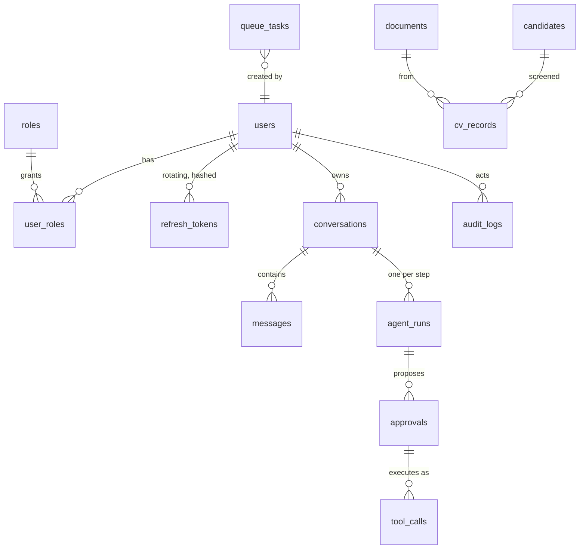
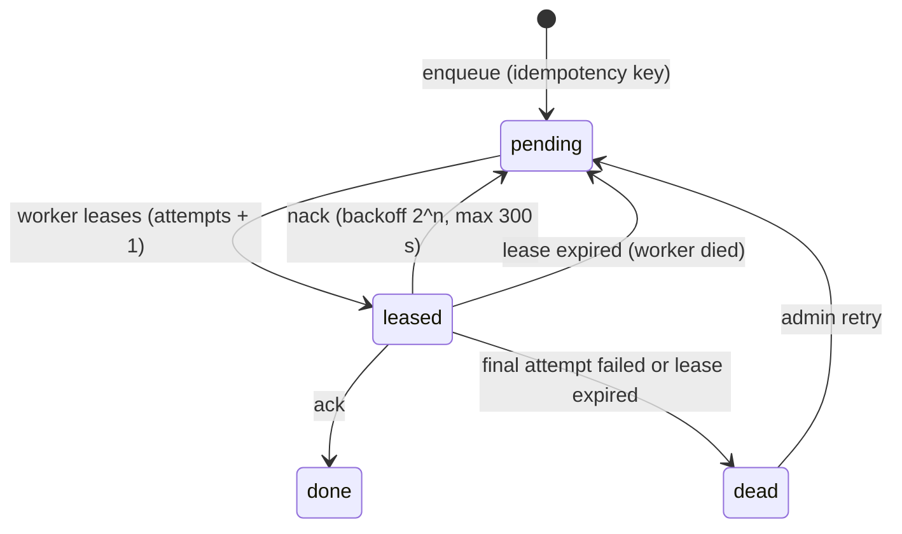

# Architecture

## Parts



- **The core reaches external systems only through MCP.** The Finance Portal and the IT Helpdesk are separate applications, each with its own database, staff sign-in and REST API. The core never opens their databases.
- **Every tool call goes through the tool gateway** (`backend/agentsmind/agents/gateway.py`). It checks four things in code:
  1. the tool exists;
  2. it is on the calling agent's allow-list;
  3. the user's role allows it;
  4. a write or destructive tool has an approved approval.

  The gateway also writes every attempt to `tool_calls`, and denials also go to the audit log.
- **MCP servers** are built on MCP Python SDK 2.3.0 (`MCPServer`, Streamable HTTP).
  - They bind to 127.0.0.1 and need a bearer token. A foreign Host header is refused (DNS rebinding).
  - Inputs and outputs are typed with Pydantic, and tools carry read, write or destructive annotations.
  - Writes take an idempotency key.
  - See `docs/MCP_TOOLS.md`.

## One request, end to end

```mermaid
sequenceDiagram
  actor U as User
  participant UI as Web app
  participant A as Assistant API (SSE)
  participant O as Orchestrator
  participant C as Calendar agent graph
  participant G as Tool gateway
  participant M as calendar-mcp
  U->>UI: "Schedule a design review tomorrow at 3 pm for 45 minutes"
  UI->>A: POST /api/assistant/messages/stream
  A->>O: plan (rules; role check per step)
  O->>C: understand: time parsed in code (Asia/Karachi)
  C->>G: calendar_check_availability (read)
  G->>M: MCP call (token, timeout, read retries)
  M-->>G: busy slots and conflicts
  C->>G: calendar_create_event (write)
  G-->>C: approval_required (pending Approval #id)
  A-->>UI: events: plan, step, step, result (approval card)
  U->>UI: Approve
  UI->>G: POST /api/approvals/{id}/approve
  G->>M: create with the approval's idempotency key
  M-->>G: created, then read back (verified)
  G-->>UI: "Design review was created. Read back: confirmed."
```

## Agents

Each agent is a LangGraph `StateGraph` with the same nodes:

| Node | What it does |
|---|---|
| understand | Turns the request into an intent and slots, in code |
| gather | Calls read tools only |
| propose | The approval node |
| respond | Writes the final cards |
| clarify | Asks for a missing detail |
| fail | Turns any error into an error card |

Conditional edges connect the nodes, and every node has an error edge to `fail`. The
orchestrator splits a message into steps ("... and then ..."), routes each step to an agent,
checks the user's role, and remembers a clarifying question for the next message. See
`docs/ASSISTANT.md`.

| Agent | Tools (allow-list) |
|---|---|
| Calendar | calendar_list_events, calendar_check_availability, calendar_create_event, calendar_update_event, calendar_cancel_event |
| IT | it_create_ticket, it_get_ticket, it_list_tickets, it_update_ticket_status, it_add_comment |
| Finance | finance_list_people, finance_get_person, finance_search_people, finance_summary, finance_list_payments, finance_create_person, finance_update_person, finance_delete_person |
| Email | gmail_read_inbox, gmail_send_email |
| Documents | drive_list_files, drive_search, drive_read_file |
| HR | drive_*, gmail_*, calendar_check_availability, calendar_create_event |
| Orchestrator | queue_stats, agent_status |

**Models never do arithmetic.** Payroll totals come from SQL in the Finance Portal. Dates and
durations are computed by `agents/timeparse.py`. CV scores are weighted sums in code.

## Data



The core database:

- runs on SQLAlchemy 2 with Alembic migrations (`db/migrations/versions/0001`, `0002`, `0003`);
- is SQLite by default, or PostgreSQL through `DATABASE_URL`;
- stores times as aware UTC;
- stores money as integer minor units in the Finance Portal.

## Work queue

`QUEUE_BACKEND=db` is durable and is the default. `memory` is for tests only.



A worker that is killed mid-task loses its lease, and another worker picks the task up. This is
covered by the kill-and-restart test in `tests/backend/test_queue.py`.

## Sandbox and live modes

| Part | Sandbox (default) | Live |
|---|---|---|
| Model | Deterministic rules and templates, labeled Simulated | OpenAI (`OPENAI_API_KEY`), JSON mode plus Pydantic validation |
| Calendar | SQLite calendar (`data/calendar_sandbox.db`) | Google Calendar (`calendar.events.owned`, `calendar.freebusy`) |
| Gmail | `sandbox_data/inbox.json`; sends go to a local outbox | Gmail API (`gmail.readonly`, `gmail.send`) |
| Drive | `sandbox_data/drive/` | Drive API (`drive.readonly`) |
| System email (password reset) | Admin outbox | Not connected yet; the outbox stays the delivery path |

## Ports

| Port | Part |
|---|---|
| 8000 | Core API and web app (`run_all.ps1`); the gate uses 18000 |
| 5173 | Vite dev server (development only) |
| 8101 to 8104 | finance-mcp, it-mcp, calendar-mcp, workspace-mcp |
| 8201, 8202 | Finance Portal, IT Helpdesk |
