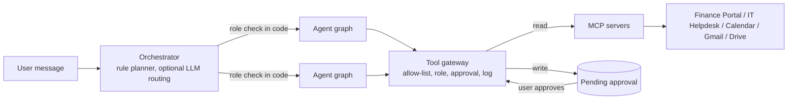

# The AgentsMind assistant

One message in, a list of cards out. The assistant never changes anything on its own:
every write is an approval card that runs only when the user approves it.



## Orchestrator (`backend/agentsmind/assistant/orchestrator.py`)

- **Planning is deterministic.** The message is split into clauses ("and then", "then", "also", ";", sentences). "and" splits only when both halves clearly belong to different agents. Each clause goes to the agent whose vocabulary matches best, with a boost for the leading verb ("schedule", "reply", "raise", "summarize", "screen").
- **Multi-step plans.** "Raise a ticket because my printer is broken and then schedule a call with IT tomorrow at 2 pm" becomes two steps: IT, then Calendar. Each step runs its own graph and is recorded as an `agent_runs` row.
- **Clarifying questions.** When an agent needs a detail (a time, a department, which of two events), it asks. The question is saved with the conversation, and the next message answers it ("tomorrow at 11 am").
- **Fallback.** If nothing matches and a language model is configured, the model may pick one agent from a fixed list (validated by Pydantic). Otherwise the user gets a card listing what they can ask, limited to the agents their role may use.
- **RBAC in code.** Before a step runs, the user's roles are checked against the agent. A refused step returns a "not available to your role" card and writes `access.denied` to the audit log. The gateway checks again for every tool call.

## Agent graphs (`backend/agentsmind/assistant/base.py`)

Every agent runs the same LangGraph `StateGraph`:

```
START -> understand -> gather -> propose -> respond -> END
             |            |         |
             |            |         +--> fail -> END        (error edge)
             |            +--> clarify -> END               (needs a detail)
             +--> clarify / fail
```

- `understand` parses the request into an intent and slots with code (no tools).
- `gather` calls read tools only: lists, free/busy, searches, file reads.
- `propose` is the approval node. Each proposed write goes through the gateway, which stores a pending `Approval` and returns its id. The card shows exactly what will run.
- `fail` turns any exception into an error card with a safe message. A failing model call (`LLMError`) is shown as such, never passed off as an answer.

## Agents

| Agent | Who | Reads | Proposes (approval) |
|---|---|---|---|
| Calendar | all staff | list events, free/busy | create (with optional Meet link), move, cancel (destructive) |
| IT | all staff | ticket status, ticket lists (own tickets outside IT) | raise a complaint ticket; IT staff: change status, comment |
| Finance | finance | payroll summary (SQL in the portal), people search, payments | update a person, add a person, delete (destructive, type the name) |
| Email | all staff | inbox (untrusted text, suspicious messages flagged) | send an email, reply, draft replies to unread mail (one card each) |
| Documents | hr, it, finance | Drive search, list and read | none |
| HR | hr | job description and CVs from Drive | none (screening only ranks; people move candidates) |

## Dates and times (`backend/agentsmind/agents/timeparse.py`)

Parsed by code in the user's time zone (`TIMEZONE`, default Asia/Karachi), never by a model:

- "tomorrow at 3 pm for 45 minutes", "next Monday at 10:30", "on 1 December at noon for an hour", "in 3 days at 9 am".
- "Monday", "this Monday" and "next Monday" all mean the first Monday after today. A date without a year is its next occurrence.
- No duration means 30 minutes, and the card says "(default)". A time in the past is refused with a question.
- "Friday afternoon" without a time: the agent checks free/busy and offers free 30-minute slots (12:00 to 17:00).

The approval card always shows the exact interpreted time, the phrase it came from, the time zone, conflicts, attendees, whether a Meet link is added, and whether the calendar is Simulated or Google.

## Untrusted text (`backend/agentsmind/agents/untrusted.py`)

Emails, CVs and documents are written by other people:

1. Before any model sees them they are wrapped in `<untrusted id="random">` blocks, and any marker inside the text is neutralised so it cannot close the block.
2. Prompt-injection phrasing is detected and shown as a warning on the card ("treated as data and ignored").
3. Models never choose tools, recipients or targets. Reply recipients come from the From header of the email answered, and send recipients from the user's own words. Every send still needs an approval.

Tested with the hostile email in `sandbox_data/inbox.json` and the hostile CV in `sandbox_data/drive/HR/CVs/`.

## CV screening (`backend/agentsmind/assistant/screening.py`)

1. The job description becomes must-have and nice-to-have criteria (code).
2. A keyword check (code) and a rubric (model, or a labeled deterministic stand-in in sandbox mode) score each criterion. The rubric must quote evidence from the CV; a quote that is not in the CV is discarded.
3. Scores are weighted in code (must 70%, nice 30%).
4. **Needs human review** when the two scores differ by 25 points or more, the CV contains instructions aimed at the AI, evidence was invented, or the model failed.
5. Names, contact details, age and date of birth, gender, marital status, nationality, religion, photos and addresses are removed before the rubric step and never scored.

Results go to the HR candidates board (`/api/hr/candidates`). Only a person moves a candidate to shortlisted, interview or rejected; re-screening never overwrites that decision.

## API

| Method | Path | Notes |
|---|---|---|
| POST | `/api/assistant/messages` | `{text, conversation_id?}` returns `{conversation_id, cards[], planner, steps[], pending, simulated, llm}` |
| POST | `/api/assistant/messages/stream` | Same, as Server-Sent Events: `plan`, `agent`, `step` while working, then `result` |
| GET | `/api/assistant/conversations`, `/api/assistant/conversations/{id}` | Own conversations only |
| GET/POST | `/api/approvals`, `/api/approvals/{id}/approve`, `/api/approvals/{id}/reject` | Destructive approvals need `confirm=true`. The approve response includes a plain-language result and links (ticket confirmation page, Meet link) |
| GET/PATCH | `/api/hr/candidates`, `/api/hr/candidates/{id}` | HR only; PATCH `{stage, notes?}` is audited |

Card kinds: `text`, `result` (with `data.columns` and `data.rows`), `clarify` (with `options`), `approval` (with `approval.details`, `warnings`, `confirm_text` for destructive actions), `error`, `denied`, `fallback`. Every card has `simulated` and `untrusted` flags.

## Connecting Google (optional)

Until this is done, Calendar, Gmail and Drive run in the labeled sandbox.

1. In Google Cloud Console, create an OAuth client of type "Desktop app" and enable the Google Calendar API, Gmail API and Google Drive API.
2. Save the client JSON as `secrets\google_oauth_client.json` (gitignored).
3. Run `.venv\Scripts\python scripts\google_oauth.py` and approve in the browser. The token is stored encrypted in `data\google_token.enc` with `GOOGLE_TOKEN_ENCRYPTION_KEY`.
4. Restart `scripts\win\run_all.ps1`. `/api/admin/mcp` and the cards now say Google instead of Simulated.

Scopes requested (narrowest that work): `calendar.events.owned`, `calendar.freebusy`, `gmail.readonly`, `gmail.send`, `drive.readonly`.
