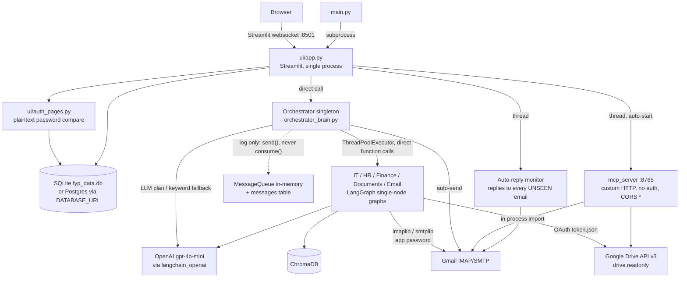

# AgentsMind: Phase 0 Audit Report

Date: 2026-10-28
Audited commit: `42838d5` (GitHub `FaizAhmeddev/multi-agent-system-fyp`, branch `main`, 2026-07-08)
Branch for this phase: `phase/0-audit`. No application code was changed. The only additions are `tests/characterization/` and this report.

## 0. How this audit was done, and its limits

| Activity | Status | Evidence |
|---|---|---|
| Clone and inventory the repo | Run | 80 tracked files, 17,642 lines (`wc -l`) |
| Compare GitHub with the local copy on the user's computer | Run | `diff -rq`: 7 files differ, and GitHub is newer in each of them (see section 1.3) |
| Clean virtualenv install, then launch the app | **Not run (blocked)** | `pip install -r requirements.txt` failed with `Could not resolve host: pypi.org`. The session egress proxy returns `CONNECT tunnel failed, response 403` for pypi.org, and npm is blocked the same way |
| Lint (ruff 0.16.9, rules F and E9) | Run | 34 findings, no undefined names (F821 = 0) |
| Security lint (ruff S, the bandit rule set) | Run | 80 × S110 (`try/except/pass`), plus S311, S324, S603. The `bandit` binary itself was not available |
| `pip-audit` | **Not run** | Needs PyPI access |
| Secrets scan of the full git history | Run (regex, not gitleaks) | No API keys, no OAuth secrets, no tokens. Personal data was found (see P3) |
| Characterization tests | Run | `51 passed in 1.28s` on Python 3.13 with the dependencies stubbed (see section 7) |
| MCP SDK version check | Run | PyPI shows `mcp` 2.3.0 (2026-10-02) as the latest release. On 2.x, `mcp.server.fastmcp` raises ImportError: FastMCP was renamed `MCPServer` |

Anything below marked **static** comes from reading code, not from running it.

## 1. Inventory

### 1.1 Layout (repo root)

```
README.md            root README (heading markup broken: line 1 lacks "#")
requirements.txt     identical to FYP_FINAL/requirements.txt except the comment header
runtime.txt          "python-3.11\n"   (FYP_FINAL/runtime.txt is "python-3.11" with no newline)
.devcontainer/       runs `streamlit run FYP_FINAL/main.py --server.enableXsrfProtection false`
FYP_FINAL/
  main.py                    entry point: spawns `streamlit run ui/app.py` as a subprocess
  config.py         437 L    env loading, USERS with default passwords, RBAC maps, paths
  Orchestrator/orchestrator_brain.py  3,104 L  routing, preflight, LLM planning, agent invoke, email send
  ui/app.py        3,226 L   Streamlit UI (8 tabs), 80 × unsafe_allow_html
  ui/auth_pages.py   599 L   login / signup / OTP / forgot password
  database/sqlite_db.py 1,435 L  SQLAlchemy models (20 tables), create_all, ad-hoc ALTERs
  database/vector_db.py      ChromaDB wrapper
  data_loader/loader.py      generates and embeds 5 synthetic datasets into Chroma on first run
  message_queue/queue.py     in-memory pub/sub with a best-effort DB log
  mcp_server/server.py       custom HTTP JSON server on :8765 (not the MCP protocol)
  agents/                    it_support, auto_reply, hr, finance, documents (LLM prompt functions)
  graph/                     5 LangGraph graphs, each a single node (email_graph: read→reply→send)
  state/                     TypedDicts
  recruitment/               CV parse → JD analysis → match → shortlist → draft → send pipeline
  tools/                     gmail_read/send (IMAP/SMTP with app password), Drive client,
                             HR Gmail shortlist (1,176 L), finance export (PDF/XLSX/DOCX)
  auth/otp_service.py        OTP generation and email delivery
  utils/                     file_parser, logging_config, finance charts
  scripts/test_orchestrator_routing.py  manual regression script (needs a live OpenAI key)
  logs/orchestrator.log      COMMITTED: 913 lines of real prompts, including email addresses
```

### 1.2 Things that do not exist

There is no test suite (no pytest config and no `tests/`), no Alembic migrations, no FastAPI app, no React frontend, no calendar code, no Finance or IT portal, no password hashing, and no approval step.

### 1.3 GitHub compared with the local folder

The local copy (`UPDATED VER FYP`) is an older snapshot. GitHub `main` has newer code in each of the 7 files that differ: queue persistence, offer-letter routing, the onboarding missing-field check, and a `FYP_ENABLE_MQ` default of `true` (the local copy has `false`). The local copy also has compiled `__pycache__` for `onboarding/` and `whatsapp/` modules whose source no longer exists anywhere. **GitHub `main` is the baseline.** The local folder also holds `.env`, `credentials.json` and `token.json`. None of these are in git history (verified). Their contents were not read.

## 2. Real architecture (as built)



Key points:

- The agents never use the queue. The orchestrator calls them directly through a thread pool and writes `task`/`result` messages purely as a log (`orchestrator_brain.py:2404`, `:2448`). Nothing calls `consume()` outside the UI preview.
- The "MCP server" is a `BaseHTTPRequestHandler` with `/tools` and `/call` endpoints (`mcp_server/server.py:183-243`). It does not speak MCP (JSON-RPC, initialize, capabilities). Nothing in the app calls it over HTTP: the UI only starts it (`ui/app.py:1418`).
- `tools/mcp_drive_client.py:43-85` `MCPDriveClient` posts to `api.anthropic.com` with no API key and a model id against an invented "drivemcp" URL. It is dead code, since `DriveClient._use_direct = True` always.

## 3. Findings by severity

Severity scale: **Critical** means a remote or easy compromise, or an irreversible outward action without consent. **High** means a security or data-integrity defect. **Medium** means a wrong result or a reliability problem. **Low** means hygiene.

| # | Sev | Finding | Evidence |
|---|---|---|---|
| 1 | Critical | The MCP HTTP server has no authentication and sends `Access-Control-Allow-Origin: *`, including on the preflight that allows `Content-Type`. Any web page open in the user's browser can POST `/call {"name":"gmail_send_email"}` and send mail from the configured Gmail account, or read the inbox and Drive. It auto-starts whenever the UI runs locally. | `server.py:195,213-235,237-243`, `ui/app.py:1414-1425`. Test `test_no_auth_and_wildcard_cors` |
| 2 | Critical | Email goes out with no approval step. Any Assistant prompt that contains an address triggers SMTP send. | `orchestrator_brain.py:2710-2741`. Test `test_email_is_sent_without_approval_when_address_in_prompt` |
| 3 | Critical | The auto-reply monitor replies by LLM to **every** unseen email, with no loop guard, no allow-list and no human review. Any email mentioning "MERN" gets a hard-coded "you have been shortlisted, interview Monday 2:00 PM". | `gmail_auto_reply_monitor.py:56-92`, `auto_reply_agent.py:17-49,77-78`. Test `test_auto_reply_hardcodes_shortlist_for_any_mern_email` |
| 4 | Critical | Default passwords (`admin123`, `hr123`, `finance123`, `it123`, `demo123`, `assistant123`), advertised on the login page. Two of the six accounts are full Admin. The local DB still uses these defaults (password lengths 8/5/10/5/7/12 match; values not printed). | `config.py:318-349`, `auth_pages.py:394-398`. Test `test_default_demo_passwords_exist_when_env_not_set` |
| 5 | High | Passwords are stored and compared in plaintext. There is no lockout and no rate limit. Login accepts **either** the DB value or the config value, so changing `FYP_PASSWORD_*` after the first run leaves the old password working. | `sqlite_db.py:222,886-914` |
| 6 | High | OTP uses `random.choices` (not cryptographic) and allows unlimited guesses. `AUTH_OTP_DEV_FALLBACK` defaults to `true`, which shows the reset code on screen whenever Gmail is unset, so anyone can take over any self-registered account. | `otp_service.py:12-13,60-65`, `auth_pages.py:293-296`. Test `test_otp_uses_non_crypto_random_and_dev_fallback_on_by_default` |
| 7 | High | Personal data is in git history: `database/fyp_data.db` was committed in 5 commits (2026-05-15 to 05-23) with `emails` (5 real-looking addresses at gmail.com and pm.me), `whatsapp_logs`, `candidates` and `tasks`. `logs/orchestrator.log` is still tracked and contains user prompts and addresses. | `git log --all -- FYP_FINAL/database/fyp_data.db`, `git ls-files FYP_FINAL/logs` |
| 8 | High | Untrusted text (CVs, inbound email bodies, documents) is pasted into prompts without delimiting. LLM output is trusted with no schema validation. A hostile CV gets the score it asks for. | `hr_agent.py:24-45`. Test `test_hostile_cv_text_is_inlined_undelimited` |
| 9 | High | The orchestrator is one process-wide instance holding per-request state (`self._agent_tasks`, `self._finance_export_files`). Concurrent sessions can overwrite each other's plan, so user A's task can run under user B's request. **Static** finding (race not reproduced). | `orchestrator_brain.py:2017-2023,2145-2146,2195,2300,3065` |
| 10 | High | RBAC fails open: an unknown role sees all tabs and all agents. The `Assistant` role can reach the finance, HR, IT and documents agents. Enforcement happens in Streamlit UI state, not at a service boundary. | `config.py:391-407`. Tests `test_unknown_role_*`, `test_assistant_role_can_reach_*` |
| 11 | High | The MCP `gmail_send_email` reports `success: true` even when the send failed, because `send_email` returns a status string and never raises. | `server.py:147-153`. Test `test_gmail_send_reports_success_even_when_send_failed` |
| 12 | Medium | SMTP falls back from :465 to :587 after **any** exception, including a timeout after DATA, so one email can be delivered twice. The recruitment sender adds 3 more retries on top. No idempotency. | `gmail_send.py:80-90`, `email_sending_agent.py:28-45`. Test `test_smtp_fallback_can_send_twice` |
| 13 | Medium | The queue is not a queue: `consume()` is destructive with no acknowledgement, retry or dead-letter state. Persistence only stores the initial status, and later status changes are never written. | `queue.py:180-193`. Test `test_consume_is_destructive_no_ack_no_redelivery` |
| 14 | Medium | LLMs do arithmetic: expense totals, payroll and budget variance are computed in the prompt. | `finance_agent.py:44-60,104-130` |
| 15 | Medium | The IT agent writes a ticket row for every IT question (no approval, no ticket workflow). There is no status, assignee or SLA. | `it_support_agent.py:87-91` |
| 16 | Medium | An LLM error during CV screening silently scores the candidate 0 / "Not Recommended". | `hr_agent.py:47-55`. Test `test_llm_error_silently_rejects_candidate` |
| 17 | Medium | Routing errors: "What is the total monthly payroll?" goes to HR, and "Schedule a meeting…" goes to HR because there is no calendar agent. | Tests `test_payroll_question_routes_to_hr_not_finance`, `test_no_calendar_agent_exists` |
| 18 | Medium | MCP `gmail_read_inbox` ignores `max_emails`/`unread_only`. `drive_read_file` with only `file_name` passes `file_id=None` to the Drive API. | `server.py:124-130,78-89`. Test `test_gmail_read_inbox_ignores_its_parameters` |
| 19 | Medium | Uploads are checked by extension only. A PDF that fails to parse falls back to `bytes.decode()`, so arbitrary bytes reach the LLM. There is no project size limit (Streamlit default 200 MB) and no filename sanitising. | `ui/app.py:1059-1081`, `.streamlit/config.toml`. Test `test_parser_selects_by_extension_not_content` |
| 20 | Medium | Errors are swallowed: 80 `try/except/pass` and 262 `except Exception`. Examples: `seed_app_users_from_config`, `_migrate_auth_schema`, and MCP bind failure, where `mcp_running` is set to True even if the bind failed. | ruff S110, `server.py:272-276`, `ui/app.py:1422-1425` |
| 21 | Medium | No migrations: schema changes are hand-written `ALTER TABLE` inside a swallowed try. The local DB is already behind (no `is_system_account` and no `auth_otps`). | `sqlite_db.py:324-351`, local DB `pragma table_info(app_users)` |
| 22 | Medium | Entry points disagree. The root README says `python main.py` from the repo root, but `main.py` lives in `FYP_FINAL/`. The devcontainer runs `streamlit run FYP_FINAL/main.py`, which calls `run()`, which spawns a second Streamlit on 8501 because `STREAMLIT_SERVER_PORT` is not set by Streamlit. **Static** finding, not run. XSRF protection is disabled in the devcontainer. | `README.md:9-12`, `main.py:172-186`, `.devcontainer/devcontainer.json:22` |
| 23 | Medium | Side effects at import time: `config` loads `.env` with `override=True`, the orchestrator sets `os.environ["OPENAI_API_KEY"]`, and the queue singleton registers queues. This makes testing hard. | `config.py:41`, `orchestrator_brain.py:27` |
| 24 | Low | Gmail uses IMAP/SMTP with an app password, not the Gmail API. Drive uses OAuth with `drive.readonly` (good scope), but `token.json` is written in plaintext into the project folder. | `mcp_drive_client.py:149-221` |
| 25 | Low | `tools/email_memory_db.py` is unused (no importers) and backed by a JSON file that does not exist locally. **Nothing to migrate.** | `grep -rn email_memory` |
| 26 | Low | `pypdf` is imported as a fallback but not listed in requirements (only `PyPDF2`). | `file_parser.py:60`, `cv_parser.py:14` |
| 27 | Low | The two requirements files are duplicates, `runtime.txt` is duplicated (one without a trailing newline), all versions are `>=` with no lockfile, and `which_python.txt` is a committed Windows `where` output. | `diff requirements.txt FYP_FINAL/requirements.txt` |
| 28 | Low | The capitalised `Orchestrator/` package works on Linux because every import uses the same case (2 imports). It is non-standard and should become `orchestrator`. | `ui/app.py:907`, `scripts/test_orchestrator_routing.py:12` |
| 29 | Low | Hygiene: 34 lint findings (unused imports, one F811 redefinition), 97 emoji in source and READMEs, gradient banners in `config.py:410-423`, an MD5 hash used for document IDs. | ruff output |
| 30 | Low | Port 8765 is bound on `localhost` by default (good), but it is configurable to `0.0.0.0` with no token, and `FYP_HOSTED` is auto-detected through several heuristics. | `config.py:270-309` |

## 4. Specific checks requested

| Check | Result |
|---|---|
| Entry point | `FYP_FINAL/main.py` → subprocess `streamlit run FYP_FINAL/ui/app.py`. Must be run from `FYP_FINAL/`, or by absolute path. |
| Duplicate requirements | Yes, two copies that differ only in comments. |
| runtime.txt | Two copies, both `python-3.11` (Streamlit Cloud format). |
| Capitalised Orchestrator imports | Consistent, so they work on case-sensitive filesystems. Rename recommended. |
| Port 8765 | Default `localhost:8765`, no auth, CORS `*` (finding 1). |
| Default passwords | Present (finding 4). |
| Queue behaviour | In-memory and log-only, no consumers, no ack (finding 13). |
| MCP auth | None (finding 1). |
| Upload handling | Extension-based, no size limit, no sanitising (finding 19). |
| Gmail/Drive token storage | Gmail: app password in `.env`. Drive: `token.json` plaintext, gitignored, never committed. |
| email_memory_db.py | Dead code with no data (finding 25). |
| Secrets in git history | None found. Personal data found (finding 7). |

## 5. README claims verified

| Claim | Verdict | Note |
|---|---|---|
| `pip install -r requirements.txt && python main.py` from root | **Partial** | Install not run (blocked). `python main.py` at root fails because the file is not there. |
| Opens at localhost:8501 | Not verified | Could not run. |
| Orchestrator: LLM intent → A2A routing | **Partial** | LLM planning exists. "A2A" is a log; agents are called directly. |
| Message queue pub/sub A2A protocol | **Partial** | Publish and subscribe exist, but no consumer uses them. |
| MCP server with 7 tools | **Partial** | The 7 tools exist (test `test_lists_seven_tools`), but it is not MCP protocol, has no auth, and 2 tools have bugs. |
| IT Support step-by-step | Implemented | LLM prompt plus a Chroma KB lookup. |
| Auto-Reply monitors inbox | Implemented (unsafe) | Finding 3. |
| Email coordinator: find contact → draft → send | Implemented | No approval (finding 2). |
| HR: CV screening, interview questions, onboarding, JD | Implemented | LLM only. |
| HR: policy Q&A | **Partial** | `policy_context` is never supplied, so answers come from model knowledge. |
| Finance: Q&A, expenses, invoice, reports, budget vs actual | Implemented | The LLM does the arithmetic (finding 14). |
| Documents: search, summarize, Q&A, extract, compare, batch | Implemented | Needs Drive OAuth. No citations. |
| 7 UI tabs | Implemented as 8 | Assistant, Dashboard, IT Support, Email, HR, Finance, Documents, History. |
| "Fixed lazy imports (no module-level side effects)" | **Partial** | Finding 23. |
| Project structure listing | **Partial** | Omits recruitment/, auth/, database/, data_loader/, scripts/. |
| Google Drive via `credentials.json` in project root | Implemented | Static. |
| Calendar / Finance portal / IT portal | **Missing** | Not claimed in the README, but required by the AgentsMind scope. |

## 6. Existing data that must be migrated

The local `fyp_data.db` has 20 tables. Row counts: tasks 63, emails 13, candidates 10, finance_records 22, documents_meta 450, it_tickets 3, notifications 114, recruitment_workflows 6, hr_gmail_shortlist_batches 10, login_history 68, app_users 6, conversations 13, conversation_messages 35.

Under the "synthetic data only" rule, the recommendation is to **not migrate** this database. It contains real-looking addresses and default-password users. Instead, write a seed script that recreates equivalent synthetic records. Candidates and conversations can be exported once on request if you want them kept. `email_memory_db.py` holds no data.

## 7. Characterization tests added

Location: `tests/characterization/` (51 tests). Command and result, on Python 3.13.18 with pytest 9.1.1:

```
$ python -m pytest tests/characterization -q -p no:cacheprovider
characterization stubs: langchain_openai, langgraph, sqlalchemy (database.sqlite_db recorder)
51 passed in 1.28s
```

- `conftest.py` stubs a dependency only when it is not installed. The LLM is a fake that refuses network calls. Env secrets are blanked.
- Tests marked `legacy_bug` (16) pin current wrong or insecure behaviour. Later phases must flip them on purpose, with a note in CHANGELOG.md.
- Not covered yet, because each needs the real dependencies: the Streamlit UI, `sqlite_db` (auth, conversations), the LLM routing planner, and Chroma. These will be added once PyPI is reachable.

## 8. Notes for later phases (verification so far)

- MCP Python SDK: `mcp` 2.3.0 is current stable (PyPI, released 2026-10-02, checked 2026-10-28). In 2.x, `FastMCP` was renamed `MCPServer` (`from mcp.server.mcpserver import MCPServer`), confirmed by the ImportError text from installed 2.3.0. v1.x (1.30.0) is the maintenance line. Recorded here; `docs/API_VERIFICATION.md` will be created in Phase 1.
- Gmail: the spec asks for hardened Gmail tools. The current code uses IMAP/SMTP with an app password. Moving to the Gmail API with OAuth (one consent flow shared with Calendar and Drive) is the recommendation, to be confirmed.

## 9. Top 10 problems

1. Unauthenticated, CORS-`*` tool server that can send Gmail and read the inbox and Drive (finding 1).
2. Outward emails sent with no approval (findings 2, 3), including a hard-coded "you are shortlisted" auto-reply.
3. Default passwords stored in plaintext, a demo Admin account, and no lockout (findings 4, 5).
4. OTP reset takeover through the on-screen dev fallback and the non-cryptographic RNG (finding 6).
5. Personal data in git history and a tracked log file (finding 7). This needs a history rewrite, and only you can decide on that.
6. Prompt injection: untrusted CV, email and document text drives the LLM, and its output is trusted (finding 8).
7. A shared orchestrator singleton holds per-request state, so concurrent users can collide (finding 9).
8. RBAC fails open and lives only in UI state (finding 10).
9. The "queue" and "MCP" are not what the README says: a log-only queue and a non-MCP HTTP server (findings 13, and section 2).
10. No tests, no migrations, swallowed errors and inconsistent entry points (findings 20 to 22).

## 10. Realistic plan (adjusted after the audit)

| Phase | Scope | Main risk |
|---|---|---|
| 1 Foundation | New layout (`backend/`, `agents/`, `mcp_servers/`, `external_systems/*`, `db/`, `frontend/`, `tests/`). Pydantic settings, JSON logs, `/health`. SQLAlchemy 2 models plus Alembic. Argon2 password hashing, JWT access and refresh tokens, lockout after 5 failures, first-admin password taken from env. Backend RBAC dependency. DB queue (`QUEUE_BACKEND=db|memory`) with ack, lease timeout, backoff and dead-letter. Windows no-Docker run scripts. Legacy logic moves behind adapters; the characterization tests keep passing except deliberate `legacy_bug` flips. | PyPI access. Legacy functions are huge (the orchestrator file is 3,104 lines), so they get wrapped, not rewritten, in Phase 1. |
| 2 Portals and MCP | Finance Portal and IT Helpdesk (separate FastAPI apps and DBs, server-rendered or a small React build sharing the tokens). finance-mcp and it-mcp on **mcp 2.x `MCPServer`** over Streamable HTTP, bound to 127.0.0.1 with a bearer token, Pydantic I/O, annotations, idempotency keys, a tool_calls log, allow-lists and the approval gate. | MCP 2.x API differs from the FastMCP examples, so it gets verified first. |
| 3 Agents and Calendar | Explicit LangGraph graphs (plan, then tool, then approval interrupt, then execute, with error edges). Calendar via the Google Calendar API with sandbox mode. Read-back verification. HR, Documents and Email moved to the same approval flow. The auto-reply monitor becomes "Suggest reply" with approval. | Google OAuth needs your Cloud project. An OpenAI key is needed for live runs; otherwise only a mocked LLM is available. |
| 4 UI | React + TS + Vite, tokens for light and dark themes, all 11 screens, both portal UIs, Playwright suite, Streamlit deleted. | Largest phase by volume, likely split into 4a (shell, auth, hub, assistant, approvals) and 4b (department workspaces, admin, portals). |
| 5 Quality | Coverage, bandit, pip-audit, gitleaks, clean-clone README run, docs, demo script. | None beyond tool availability. |

Honest sizing: phases 1 to 4 are each multi-session pieces of work. Each phase ends runnable, with a report.

## 11. Questions (one batch)

1. **Package access.** Can you allow pypi.org, files.pythonhosted.org and registry.npmjs.org for this workspace (claude.ai, then Settings, then Capabilities)? Without them I cannot install or run anything, which blocks every later phase.
2. **History rewrite.** Should I purge `FYP_FINAL/database/fyp_data.db` and `FYP_FINAL/logs/orchestrator.log` from git history (`git filter-repo`, then a force-push to `main`)? This rewrites every commit hash. The alternative is to stop tracking them going forward only.
3. **Gmail transport.** Should I move Gmail to the Gmail API with OAuth (one Google consent shared with Calendar and Drive), or keep IMAP/SMTP with an app password behind the new MCP tools?
4. **MCP SDK line.** Should I use `mcp` 2.x (`MCPServer`, current stable), or pin `mcp<2` to match FastMCP tutorials? I recommend 2.x.
5. **Credentials for live demos.** Will you supply an OpenAI key and a Google Cloud OAuth client (Calendar, Drive, Gmail scopes) via `.env` on your laptop? If not, I'll build everything with labeled sandbox and mock modes.
6. **Pushing.** Should I push `phase/<n>-*` branches to GitHub as I go, or keep them local and hand over patches?
